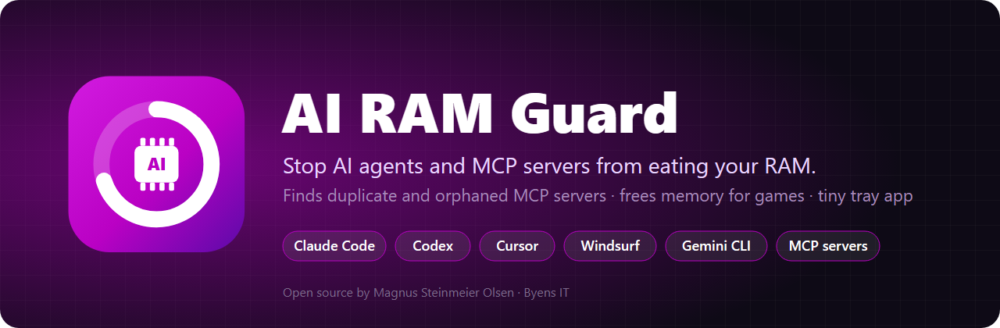
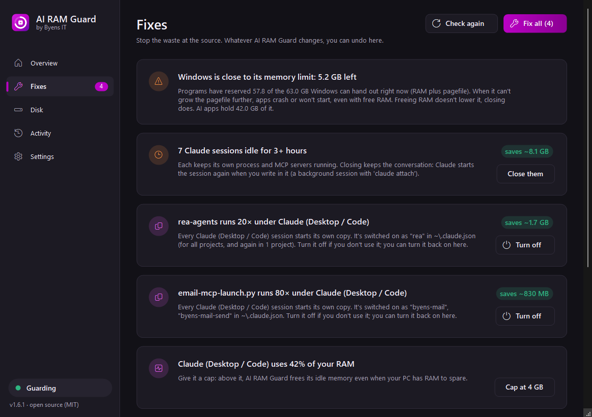

  

<a href="README.md">English</a> · <b>Dansk</b>

# AI RAM Guard: se, hvad Claude Code, Codex, Cursor og MCP-servere reelt holder på

> På en PC med 32 GB **brugte AI-værktøjerne 15 GB RAM**. De **holdt på 42 GB**.

Windows flytter inaktive processer til sidefilen, så "RAM i brug" ser fint ud. Hukommelsen er stadig reserveret. Når Windows ikke kan dele mere ud, går programmer ned eller vil ikke starte, selv med ledig RAM.

**AI RAM Guard** viser, hvad dine AI-værktøjer reelt holder på, siger, hvad der trygt kan lukkes, og lukker det med ét klik. Gratis, open source, ingen konto.

  <a href="https://github.com/byensitmagnus/ai-ram-guard/releases/latest/download/AiRamGuard-Setup.exe"><b>⬇ Download til Windows</b></a>
  &nbsp;·&nbsp;
  <a href="https://github.com/byensitmagnus/ai-ram-guard/releases/latest/download/AiRamGuard-mac-universal.dmg">Mac (beta)</a>
  &nbsp;·&nbsp;
  <a href="https://byensitmagnus.github.io/ai-ram-guard/">Downloadside</a>

Appen er på engelsk.

## Det fandt den på én PC

Én måling på udviklerens egen PC (32 GB RAM, 468 processer under Claude), 21. november 2026:

| | RAM i brug | Holdt (RAM + sidefil) |
|---|---:|---:|
| Alle AI-programmer | 15,0 GB | **42,0 GB** |
| MCP-serveren `desktop-commander`, 90 kopier | 1,1 GB | **6,7 GB** |
| MCP-serveren `email-mcp`, 40 kopier | 0,6 GB | **3,6 GB** |
| MCP-serveren `rea-agents`, 20 kopier | 0,2 GB | **1,9 GB** |
| 7 Claude-sessioner, ingen havde skrevet i i 3+ timer | | **8,1 GB** |

Windows havde delt 57,7 ud af de 63,0 GB, den kunne.

## Det gør den

- **Viser det rigtige tal.** RAM og det, der holdes med sidefilen, pr. AI-program og pr. MCP-server.
- **Advarer før grænsen.** Når Windows har delt 85 % ud, ser du det på Overview, på ikonet og i en notifikation.
- **Lukker inaktive Claude-sessioner.** Ét klik lukker sessioner, ingen har skrevet i i timevis, med deres MCP-servere. Samtalen er gemt: Claude starter sessionen igen, når du skriver i den.
- **Finder årsagen.** Den viser, hvilken MCP-server der kører i mange kopier, og hvilken config-fil der starter den. **Turn off** retter filen, og du kan fortryde. En server uden tilstand får **Share one copy**: én HTTP-kopi til alle Claude Code-sessioner (52 mailservere, 2,8 GB, blev til to).
- **Lukker efterladte hjælpere**, når deres AI-program er væk.
- **Frigør RAM uden at lukke noget.** Programmet, du arbejder i, bliver aldrig rørt.
- **Giver dit spil plads.** Strammere grænse, mens et spil kører i fuld skærm, og lavere prioritet til AI-programmer i baggrunden.
- **Rydder op på disken** og flytter en cache til et andet drev, med fortryd.

## Er det sikkert?

- Den lukker aldrig et AI-program. En session lukkes kun, når ingen har skrevet i den i timevis, og kun når du klikker **Close them**, eller efter det antal timer, du selv vælger (slået fra som standard). En session, Claude selv markerer som i gang, lukkes aldrig.
- Ud over inaktive sessioner lukker den kun en hjælper, den har **set et AI-program starte**, når programmet er væk.
- En config-fil ændres kun, når du klikker på en rettelse. Der gemmes en kopi, og **Undo** lægger den tilbage.
- Ingen netværksadgang, ingen telemetri, ingen konto, ingen administratorrettigheder.

## Installation

**Windows 10 / 11:** [hent `AiRamGuard-Setup.exe`](https://github.com/byensitmagnus/ai-ram-guard/releases/latest/download/AiRamGuard-Setup.exe), åbn filen, og klik **Install**.

**Mac (beta), macOS 13+:** [hent DMG-filen](https://github.com/byensitmagnus/ai-ram-guard/releases/latest/download/AiRamGuard-mac-universal.dmg), og træk appen til **Programmer**. Betaen viser RAM- og diskforbrug og lukker efterladte hjælpere. Den har færre funktioner end Windows.

Filerne er endnu ikke kodesignerede, så Windows SmartScreen og Mac Gatekeeper spørger før første start. [Hjælp til første åbning](docs/install.md#first-open-approval).

Hele forklaringen, kommandolinjen og FAQ står i den [engelske README](README.md).

Lavet af **Magnus Steinmeier Olsen** / [Byens IT](https://byens-it.dk). Gav den dig hukommelse tilbage, så hjælper en ⭐ andre med at finde den. [Meld en fejl](https://github.com/byensitmagnus/ai-ram-guard/issues) · [MIT-licens](LICENSE)
