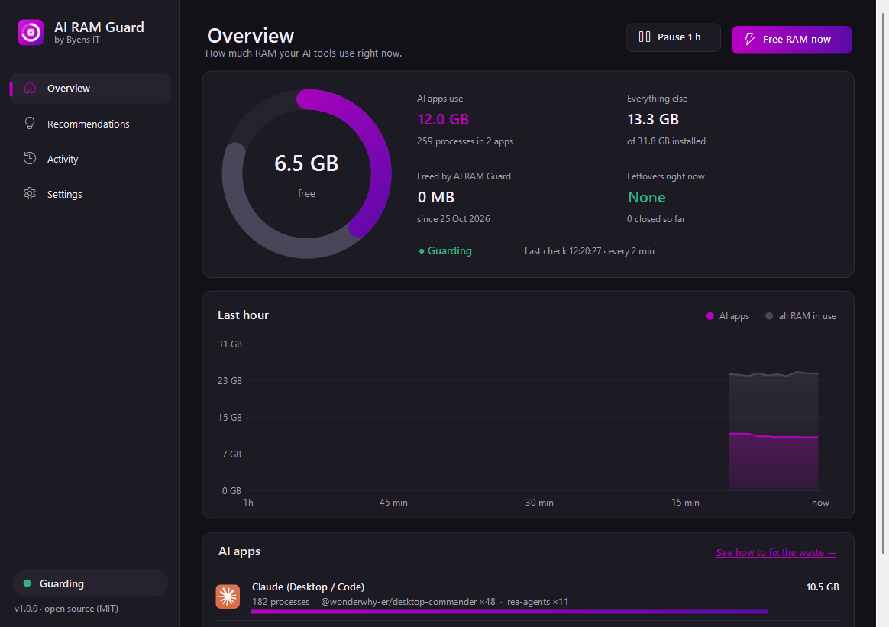

<p align="center">
  
</p>

<p align="center"><a href="README.md">English</a> · <b>Dansk</b></p>

# AI RAM Guard: når Claude Code, Codex og MCP-servere æder din RAM

**AI RAM Guard** er et gratis open source-program til Windows. Det viser, hvor meget RAM dine AI-værktøjer faktisk bruger. Det finder **dublerede og efterladte MCP-servere**, fortæller **hvilken konfigurationsfil du skal rette**, og giver hukommelsen tilbage uden at lukke det, du arbejder i.

> Det startede med en gaming-PC med 32 GB RAM, der løb tør midt i et spil. Synderen var ikke spillet. Det var **48 processer af én MCP-server** og **25 af en anden**, startet af AI-sessioner i baggrunden.

<p align="center"></p>

## Hvorfor sker det?

Hver AI-session (en Claude Code-chat, en Codex-tråd, et Cursor-vindue) **starter sin egen kopi af alle dine MCP-servere**. Hver kopi er en Node.js- eller Python-proces på 100–250 MB. Ti sessioner med fem MCP-servere giver 50 processer, ofte med en ekstra `npx`-proces foran hver.

## Det gør AI RAM Guard

- 📊 **Overblik:** RAM-ring, graf over det seneste døgn og RAM pr. AI-program med MCP-servere.
- 💡 **Anbefalinger:** finder årsagen, fx "rea-agents kører 11× under Claude, den står i `~/.claude.json`", og viser, hvad rettelsen sparer.
- 🧹 **Rydder op:** lukker MCP-servere, som den har set et AI-program starte, når programmet er væk. Det, du selv har startet, rører den ikke.
- 🪶 **Frigør RAM uden at lukke noget:** flytter ubrugt AI-hukommelse til swapfilen, når der er for lidt fri RAM. Programmet, du bruger, røres aldrig.
- 🎯 **Loft pr. program**, ⏸️ **pause i en time** og 🎮 **spiltilstand** med strammere grænse, mens et spil kører i fuld skærm.
- 📦 Rigtig installation uden administratorrettigheder, og kommandolinjen `airg` til scripts.

## Kom i gang

1. Hent `AiRamGuard-win-x64.zip` under [Releases](https://github.com/byensitmagnus/ai-ram-guard/releases/latest) og pak den ud.
2. Start `AiRamGuard.exe`, og klik **Install**.

Så ligger den i Start-menuen, starter med Windows og kan fjernes under *Indstillinger → Apps*.

```text
airg scan     RAM pr. AI-program
airg advise   hvad du skal rette, så det ikke sker igen
airg clean    ryd op nu
```

## Om

Lavet af **Magnus Steinmeier Olsen**, [Byens IT](https://byens-it.dk). Vi bygger gaming-PC'er og bruger selv mange AI-agenter. Værktøjet kom ud af at rette vores egne maskiner.

Har det sparet dig RAM? Giv repoet en ⭐. Så kan andre finde det.

MIT © 2026 Magnus Steinmeier Olsen / Byens IT
