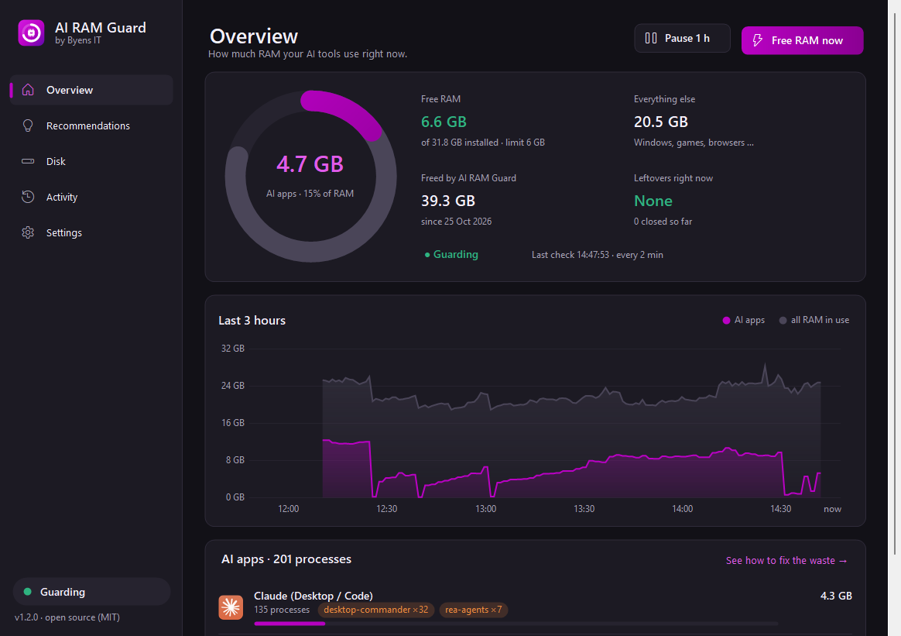

# AI RAM Guard

Se, hvor meget RAM dine AI-værktøjer bruger, og ryd op i efterladte hjælpeprocesser.

**[Download til Windows](https://github.com/byensitmagnus/ai-ram-guard/releases/latest/download/AiRamGuard-Setup.exe)** · **[Download til Mac — beta](https://github.com/byensitmagnus/ai-ram-guard/releases/latest/download/AiRamGuard-mac-universal.dmg)**

[Enkel downloadside](https://byensitmagnus.github.io/ai-ram-guard/) · [English](README.md)

## Kom i gang

| Windows 10 / 11, 64-bit | Mac, macOS 13 eller nyere |
| --- | --- |
| Hent **AiRamGuard-Setup.exe**. Åbn filen, og klik **Installér**. | Hent **DMG-filen**. Åbn den, og træk **AI RAM Guard** til **Programmer**. |
| Appen åbner automatisk og starter med Windows. Ingen udpakning eller .NET-installation. | Åbn appen fra Programmer. Samme download virker på Apple Silicon og Intel. Autostart er valgfri. |

**Godkendelse første gang:** Downloadfilerne har ikke et kommercielt signeringscertifikat. Windows kan vise SmartScreen. **Mac-betaen er endnu ikke notariseret af Apple**: efter første åbningsforsøg vælges *Systemindstillinger → Anonymitet & sikkerhed → Åbn alligevel*. [Hjælp til første åbning](docs/install.md#first-open-approval).

## Det får du

- RAM-forbrug for Claude, Codex / ChatGPT, Cursor og deres hjælpere.
- Overblik over dublerede MCP-servere og efterladte processer.
- Oprydning i hjælpere, appen tidligere har set et AI-program starte, når programmet er væk. Aktive sessioner bliver åbne.
- Diskoverblik over AI-værktøjer og deres cache.

**Windows** har også config-rettelser med backup og fortryd, hukommelsestrim, spiltilstand og cacheflytning. **Mac-betaen** har RAM-overblik, oprydning i kendte efterladte hjælpere og diskoverblik. Windows' config-editor, cacheflytning og hukommelsestrim findes ikke i Mac-betaen. [Mac-detaljer](macos/README.md).

## Hjælp

[Installation og opdatering](docs/install.md) · [Kommandolinje](docs/cli.md) · [Sådan virker det](docs/how-it-works.md) · [Meld en fejl](https://github.com/byensitmagnus/ai-ram-guard/issues) · [Alle downloads](https://github.com/byensitmagnus/ai-ram-guard/releases)

Gratis, open source, ingen konto og ingen telemetri. Lavet af **Magnus Steinmeier Olsen / [Byens IT](https://byens-it.dk)**. MIT-licens.
