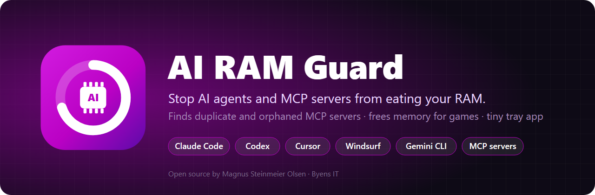
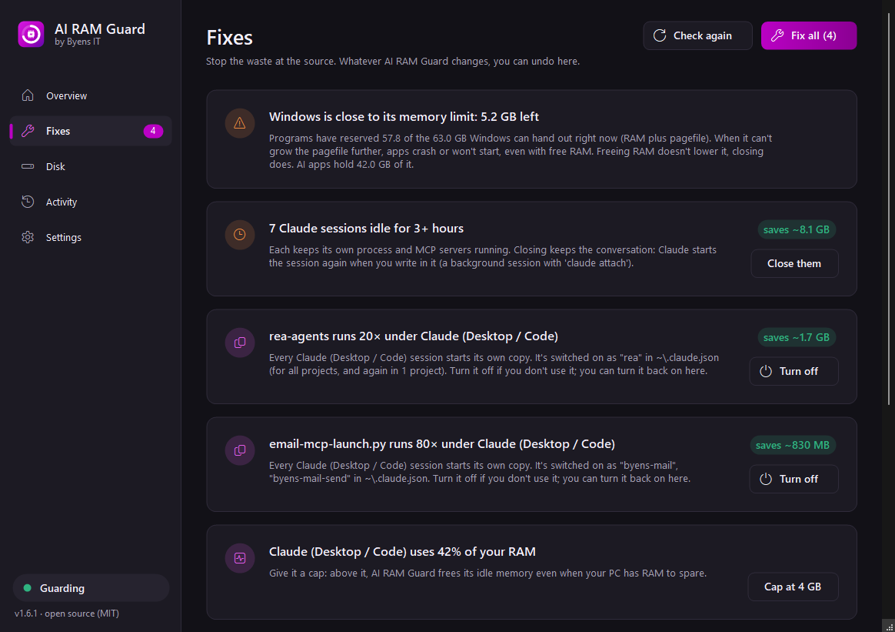
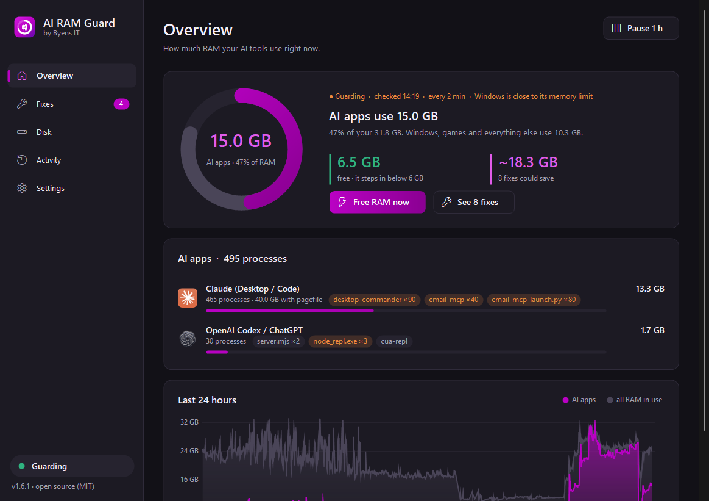
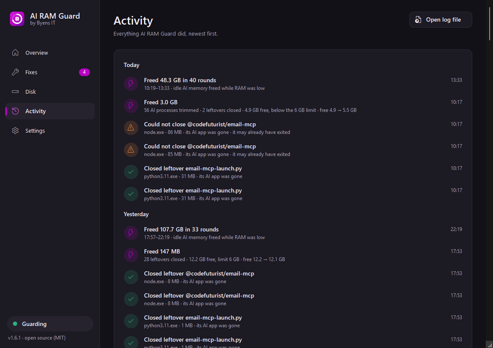
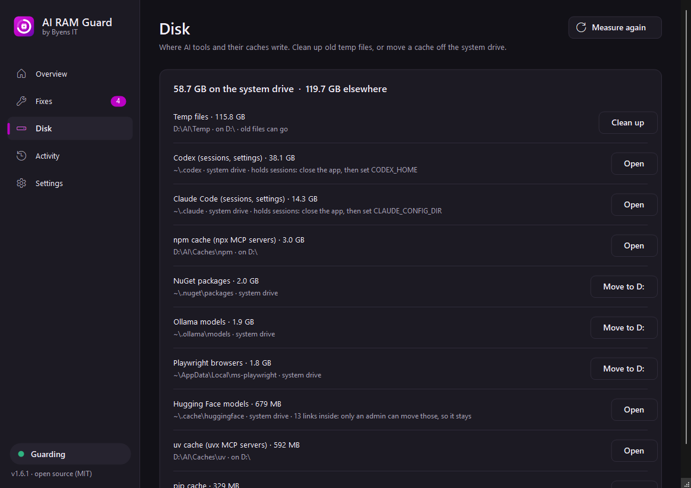

<p align="center">
  
</p>

<p align="center">
  <a href="https://github.com/byensitmagnus/ai-ram-guard/releases/latest"></a>
  <a href="https://github.com/byensitmagnus/ai-ram-guard/actions/workflows/ci.yml"></a>
  <a href="LICENSE"></a>
  
  
  
</p>

<p align="center"><b>English</b> · <a href="README.da.md">Dansk</a></p>

# AI RAM Guard: see what Claude Code, Codex, Cursor and MCP servers really hold

> On a 32 GB PC, the AI tools **used 15 GB of RAM**. They were **holding 42 GB**.

Windows moves idle processes to the pagefile, so "RAM in use" looks fine. The memory is still reserved. When Windows can't hand out more, apps crash or won't start, even with free RAM.

**AI RAM Guard** shows what your AI tools really hold, says what is safe to close, and closes it in one click. Free, open source, no account.

<p align="center">
  <a href="https://github.com/byensitmagnus/ai-ram-guard/releases/latest/download/AiRamGuard-Setup.exe"><b>⬇ Download for Windows</b></a>
  &nbsp;·&nbsp;
  <a href="https://github.com/byensitmagnus/ai-ram-guard/releases/latest/download/AiRamGuard-mac-universal.dmg">Mac (beta)</a>
  &nbsp;·&nbsp;
  <a href="https://byensitmagnus.github.io/ai-ram-guard/?lang=en">Download page</a>
</p>

<p align="center"></p>

## What it found on one PC

One scan of the author's PC (32 GB RAM, 468 processes under Claude), 21 November 2026:

| | RAM in use | Held (RAM + pagefile) |
|---|---:|---:|
| All AI apps | 15.0 GB | **42.0 GB** |
| `desktop-commander` MCP server, 90 copies | 1.1 GB | **6.7 GB** |
| `email-mcp` MCP server, 40 copies | 0.6 GB | **3.6 GB** |
| `rea-agents` MCP server, 20 copies | 0.2 GB | **1.9 GB** |
| 7 Claude sessions nobody had written in for 3+ hours | | **8.1 GB** |

"Held" is a process's private memory, wherever Windows keeps it: about what closing the process gives back. Windows had handed out 57.7 of the 63.0 GB it could. The earlier version of this app counted RAM only and said "303 MB could be saved". Counting what is held, the same PC shows about 18 GB, 8 GB of it in idle sessions.

## Why it happens

Every AI session (a Claude Code chat, a Codex thread, a Cursor window) starts **its own copy of every local MCP server** you have configured. Each copy is a full Node.js or Python process. Sessions you stopped using hours ago keep running, with all their servers. Windows pages them out, so they vanish from the RAM number while they still fill the pagefile.

It is a known problem upstream (status checked 21 November 2026):

| Issue | What people see | Status |
|---|---|---|
| [anthropics/claude-code#1935](https://github.com/anthropics/claude-code/issues/1935) | MCP servers not terminated when Claude Code exits | open |
| [anthropics/claude-code#90362](https://github.com/anthropics/claude-code/issues/90362) | 58+ orphaned `node.exe` in about 13 hours | open |
| [anthropics/claude-code#101376](https://github.com/anthropics/claude-code/issues/101376) | Idle sessions keep their MCP servers: 121 node processes, ~10 GB | closed |
| [openai/codex#53285](https://github.com/openai/codex/issues/53285) | 13 sets of MCP servers, 353 processes, ~9.6 GiB | open |
| [openai/codex#32797](https://github.com/openai/codex/issues/32797) | 147 `node.exe`, 13.9 GiB | open |

More: [Why AI tools use so much RAM](docs/why-ai-tools-use-so-much-ram.md).

## What it does

- **Shows the real number.** RAM and what is held with the pagefile, per AI app and per MCP server.
- **Warns before the limit.** When Windows has handed out 85 % of all it can, you see it on the Overview, on the icon and in a notification.
- **Closes idle Claude sessions.** One click closes sessions nobody wrote in for hours, with their MCP servers. The conversation is kept: Claude starts the session again when you write in it.
- **Finds the cause.** "`rea-agents` runs 20× under Claude, switched on in `~/.claude.json`". **Turn off** fixes the config, and you can undo it. A server that keeps no state gets **Share one copy** instead: one HTTP copy for every Claude Code session (52 mail servers, 2.8 GB, became two).
- **Closes leftovers.** MCP servers and `npx` wrappers whose AI app is gone.
- **Frees RAM without closing anything.** When free RAM drops below your limit, idle AI memory is moved out. The app you are using is never touched.
- **Gives your game room.** A stricter limit while a fullscreen game is in front, lower priority for AI apps in the background, and a cap per app.
- **Cleans up disk.** Shows where AI tools and caches write, and moves a cache to another drive with undo.
- **Has a CLI.** `airg scan`, `airg advise` and `airg disk`, each with `--json`, and `airg clean`.

<p align="center"></p>

<table>
  <tr>
    <td></td>
    <td></td>
  </tr>
  <tr>
    <td align="center"><b>Activity</b>: what it did, and why</td>
    <td align="center"><b>Disk</b>: caches off the system drive, with undo</td>
  </tr>
</table>

## Is it safe?

It is built to never break the work you are doing.

- It never closes an AI app. A session is closed only when nobody wrote in it for hours, and only when you click **Close them** or after the hours you set yourself (off by default). A session Claude marks as busy is never closed.
- Apart from idle sessions, it only closes a helper it **saw an AI app start**, once that app is gone. What you started yourself is left alone.
- Right before closing anything, it checks that the PID is still the same process.
- A config file changes only when you click a fix. A backup is kept, and **Undo** puts it back.
- No network access, no telemetry, no account, no admin rights. Everything it does is on the *Activity* page.
- It uses about 20 MB of RAM itself, and holds about 85 MB.

Details: [How it works](docs/how-it-works.md).

## Install

**Windows 10 / 11:** [download `AiRamGuard-Setup.exe`](https://github.com/byensitmagnus/ai-ram-guard/releases/latest/download/AiRamGuard-Setup.exe), open it and click **Install**. No .NET download and no admin prompt. It starts with Windows and uninstalls from *Settings → Apps*.

**Mac (beta), macOS 13+:** [download the DMG](https://github.com/byensitmagnus/ai-ram-guard/releases/latest/download/AiRamGuard-mac-universal.dmg) and drag the app to **Applications**. The beta shows RAM and disk use and closes leftovers. It has fewer features than Windows.

The downloads are not code-signed yet, so Windows SmartScreen and Mac Gatekeeper ask before the first start. [First-open help](docs/install.md#first-open-approval). Every release has a `SHA256SUMS.txt`, and you can [build it from source](docs/install.md#build-from-source).

## Command line

```text
$ airg scan
RAM: 6.4 GB free of 31.8 GB. AI apps use 15.0 GB.
Reserved (RAM + pagefile): 57.7 of 63.0 GB. AI apps hold 42.0 GB.

Claude (Desktop / Code)           468 proc   13,708 MB   40,932 MB held    84 conn
   90x @wonderwhy-er/desktop-commander                1,082 MB    6,677 MB held  <- duplicate MCP servers
   40x @codefuturist/email-mcp                          618 MB    3,565 MB held  <- duplicate MCP servers
   20x rea-agents                                       168 MB    1,863 MB held  <- duplicate MCP servers
OpenAI Codex / ChatGPT             30 proc    1,662 MB    2,061 MB held     4 conn
```

```text
airg advise                 the fixes, with the config file to change
airg clean --dry-run        show what would be closed and freed
airg clean --close-idle 3   also close Claude sessions idle for 3 hours
airg disk                   where AI tools and caches write
```

Every command and the JSON shape: [docs/cli.md](docs/cli.md).

## Supported AI apps

Claude Desktop and Claude Code · OpenAI Codex and ChatGPT desktop · Cursor · Windsurf · VS Code (Copilot and agent extensions) · Gemini CLI · Grok · LM Studio · Ollama, plus any MCP server they start.

Is your tool missing? It is a few lines of JSON: [Adding an agent](docs/adding-an-agent.md).

## FAQ

<details><summary><b>Why does Claude Code use so much memory?</b></summary>

Mostly it is not Claude itself. It is the MCP servers each session starts, and the sessions that stay alive after you stopped using them. Ten sessions with five MCP servers are fifty processes. `airg advise` names the servers and the config file that loads them.
</details>

<details><summary><b>Why are there so many "Node.js JavaScript Runtime" rows in Task Manager?</b></summary>

Each one is usually an MCP server, or an `npx` wrapper around one, started by an AI app. AI RAM Guard shows which app and which server.
</details>

<details><summary><b>Can't I just kill every node.exe?</b></summary>

That also kills the servers your live sessions use. AI RAM Guard closes only the ones whose AI session is gone or idle.
</details>

<details><summary><b>Do I lose my conversation when a session is closed?</b></summary>

No. Claude reads it back from its transcript when you write in the session again. A `claude --bg` session is listed as stopped, and `claude attach` resumes it.
</details>

<details><summary><b>I have free RAM. Why does Windows say it is out of memory?</b></summary>

Windows counts what programs have reserved, in RAM and pagefile together. Hundreds of paged-out helper processes use little RAM and a lot of that budget. Freeing RAM doesn't lower it. Closing does.
</details>

<details><summary><b>Will it make my games run better?</b></summary>

If AI tools run in the background while you play, it can free several GB, and it does so earlier while a fullscreen game is in front. It doesn't change the game itself.
</details>

## About

Made by **Magnus Steinmeier Olsen** at **[Byens IT](https://byens-it.dk)**, a Danish gaming-PC builder and IT shop. We run a lot of AI agents ourselves, and this came out of fixing our own PCs.

Found a bug, or a tool it should know? [Open an issue](https://github.com/byensitmagnus/ai-ram-guard/issues) or see [CONTRIBUTING.md](CONTRIBUTING.md). If it gave you memory back, a ⭐ helps other people find it.

[Changelog](CHANGELOG.md) · [MIT license](LICENSE)
