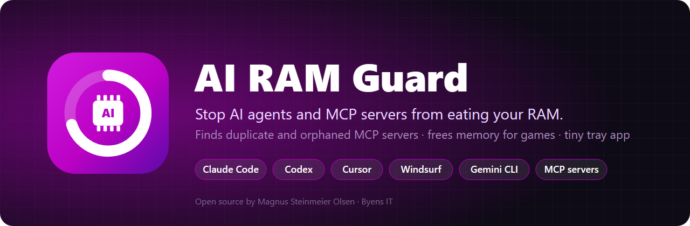
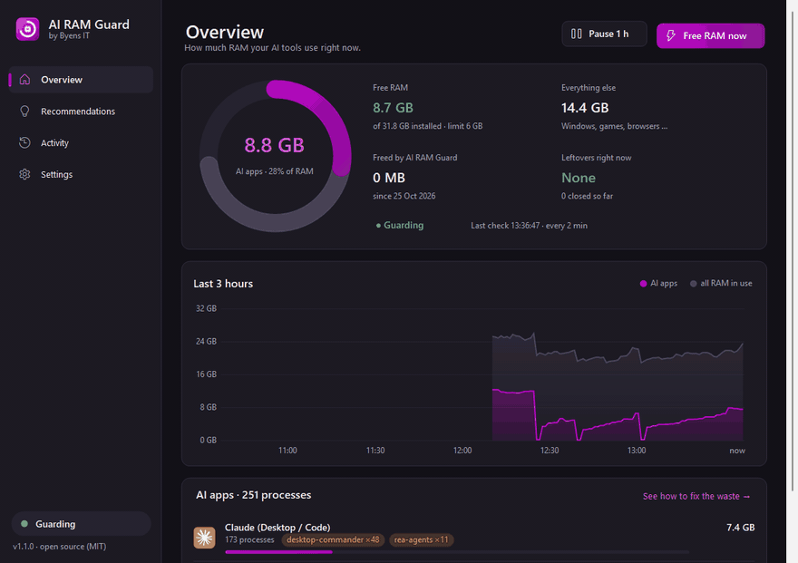
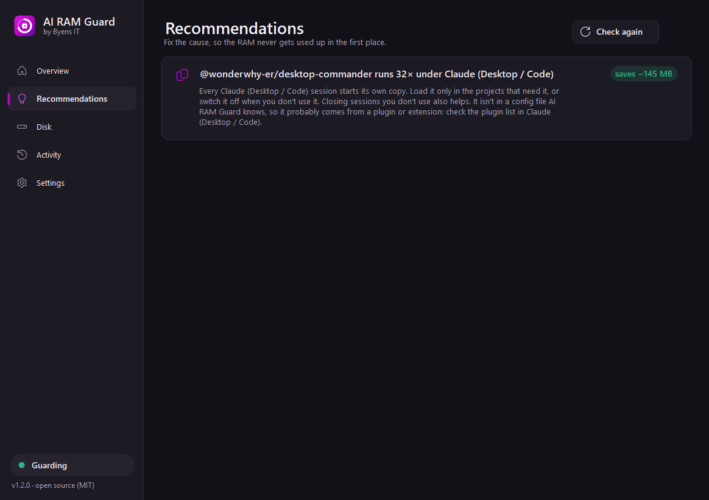
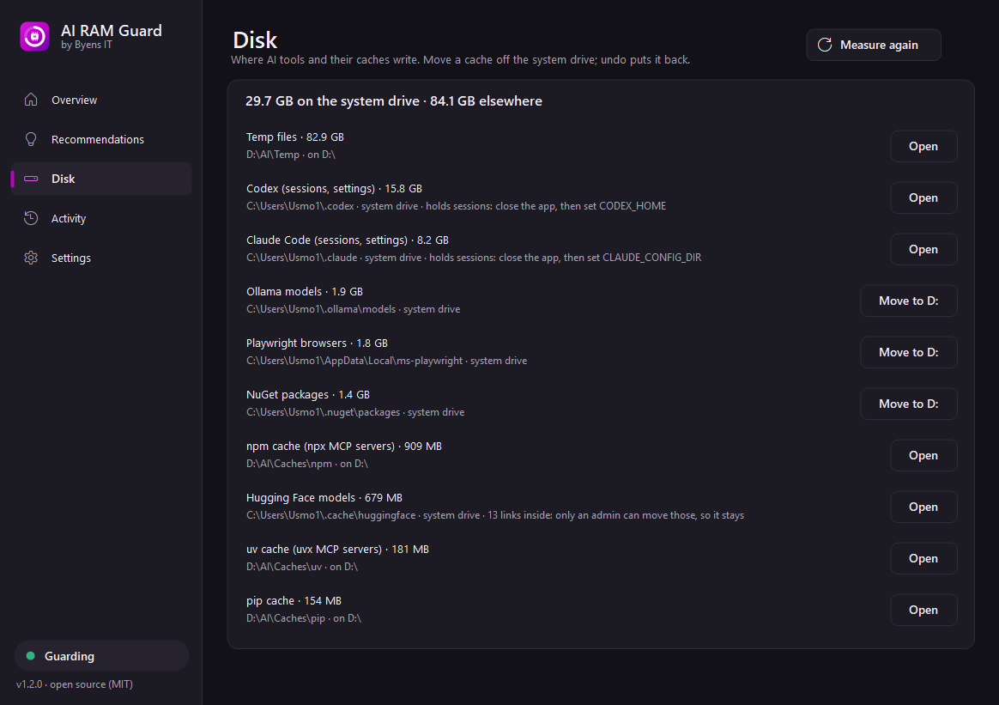
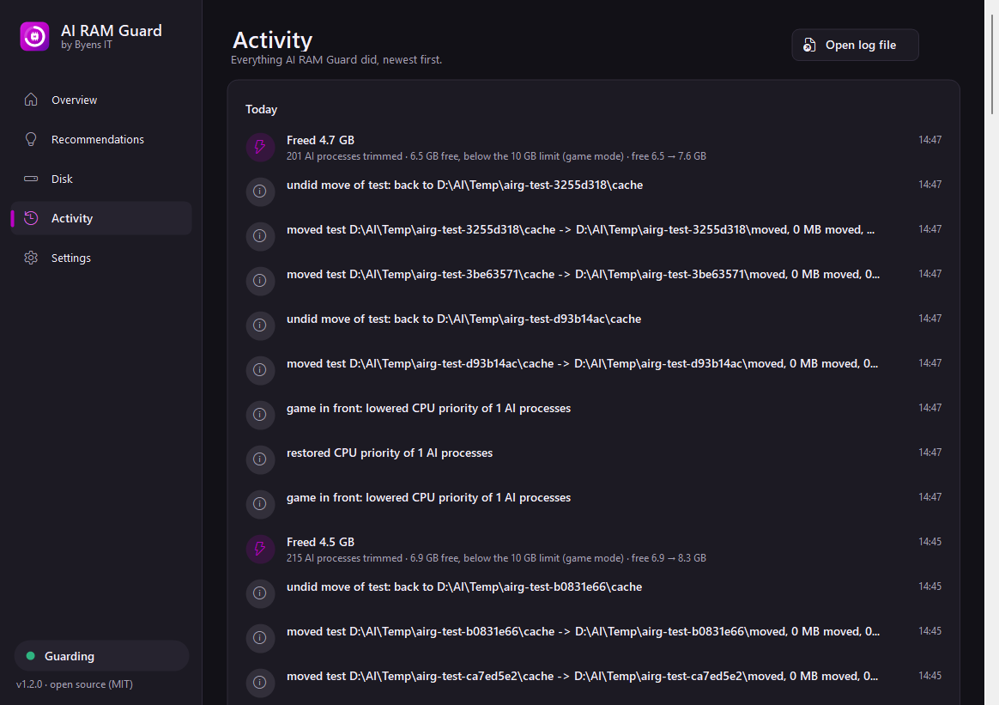
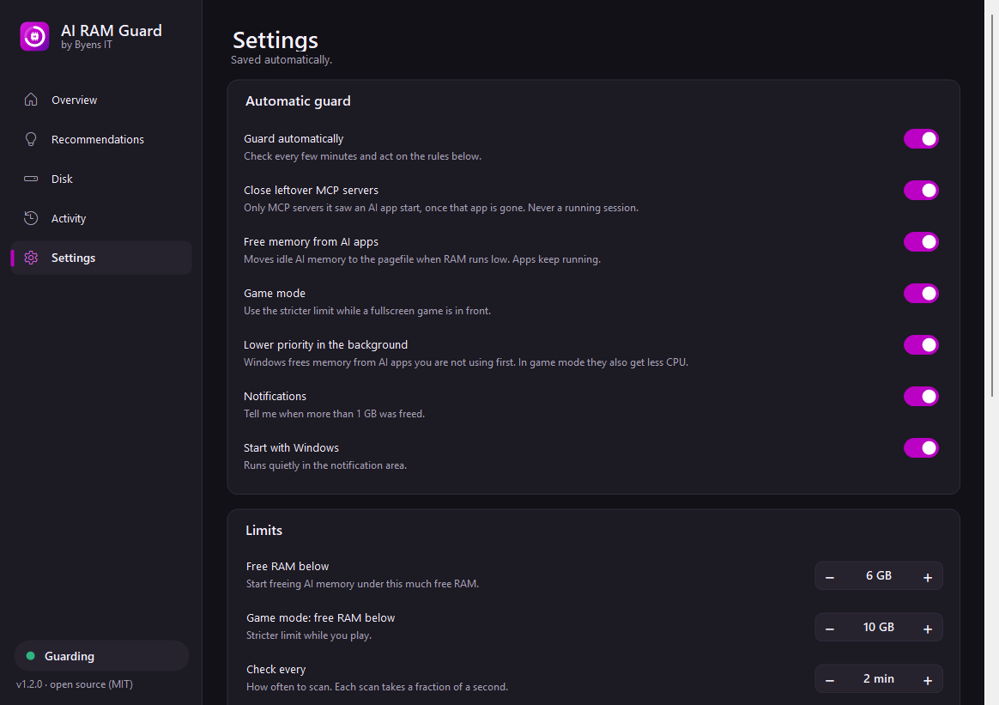

<p align="center">
  
</p>

<p align="center">
  <a href="https://github.com/byensitmagnus/ai-ram-guard/releases/latest"></a>
  <a href="https://github.com/byensitmagnus/ai-ram-guard/actions/workflows/ci.yml"></a>
  <a href="LICENSE"></a>
  
  
  
</p>

<p align="center"><b>English</b> · <a href="README.da.md">Dansk</a></p>

# AI RAM Guard: fix high memory use from Claude Code, Codex, Cursor and MCP servers

**AI RAM Guard** is a free, open-source Windows app that shows how much RAM your AI coding tools really use. It finds **duplicate and orphaned MCP servers**, tells you **which config line to change** so it stops happening, and frees memory automatically, without ever closing the app you are working in.

> Built after a 32 GB gaming PC ran out of RAM in the middle of a game. The cause wasn't the game. It was **48 processes of one MCP server** and **25 of another**, started by AI sessions open in the background.

<p align="center"></p>

## Contents
- [Why your AI tools eat RAM](#why-your-ai-tools-eat-ram)
- [Fixes these issues](#fixes-these-issues)
- [Features](#features)
- [Install](#install)
- [Command line](#command-line)
- [Supported AI apps](#supported-ai-apps)
- [Is it safe?](#is-it-safe)
- [FAQ](#faq)
- [Roadmap](#roadmap)
- [About](#about)

## Why your AI tools eat RAM

Every AI session (a Claude Code chat, a Codex thread, a Cursor window) **starts its own copy of every MCP server you have configured**. Each copy is a full Node.js or Python process, typically 100–250 MB, and with `npx` there's an extra wrapper process in front of each one.

| Open sessions | MCP servers configured | Processes | RAM |
|---|---|---|---|
| 1 | 3 | 3–6 | ~0.5 GB |
| 10 | 3 | 30–60 | ~5 GB |
| 15 | 4 + npx wrappers | 100+ | **8–10 GB** |

When an app crashes or a session ends badly, its servers can also be left **orphaned**: still running, still holding RAM, with nobody using them. Task Manager only shows a long list of identical "Node.js JavaScript Runtime" rows.

Read more: [Why Claude Code uses so much RAM on Windows](docs/why-ai-tools-use-so-much-ram.md).

## Fixes these issues

Hit one of these? AI RAM Guard works around it on your PC today, until it's fixed upstream: it closes the leftover processes and shows which config loads the duplicates.

| Issue | What you see | Status (25 Oct 2026) |
|---|---|---|
| [anthropics/claude-code#101376](https://github.com/anthropics/claude-code/issues/101376) | Idle Claude Code sessions in Claude Desktop keep their MCP servers alive: 121 node processes, ~10 GB | open |
| [anthropics/claude-code#90362](https://github.com/anthropics/claude-code/issues/90362) | MCP servers stuck in a respawn loop: 58+ orphaned `node.exe` in 13 hours | open |
| [anthropics/claude-code#58918](https://github.com/anthropics/claude-code/issues/58918) | MCP child processes not terminated on Windows after a session exits | closed, not planned |
| [anthropics/claude-code#51476](https://github.com/anthropics/claude-code/issues/51476) | High RAM use from Node MCP subprocesses on Windows | closed, duplicate |
| [openai/codex#32797](https://github.com/openai/codex/issues/32797) | Codex Desktop on Windows keeps 147 `node.exe` processes, 13.9 GiB | open |

On macOS? It's the same bug there ([claude-code#1935](https://github.com/anthropics/claude-code/issues/1935), [codex#30408](https://github.com/openai/codex/issues/30408)). A Mac version is on the [roadmap](#roadmap).

## Features

| | |
|---|---|
| 📊 **Live dashboard** | RAM ring, 24-hour history graph and a row per AI app with its icon, MCP servers (duplicates flagged) and its share of your RAM. |
| 🕑 **Activity timeline** | Everything the guard did, in plain words: what it freed, which leftovers it closed and why. |
| 💡 **Recommendations** | Finds the *cause*: "`rea-agents` runs 11× under Claude: it's configured in `~/.claude.json`", "12 npx wrappers in front of desktop-commander", with the RAM each fix saves and a button that opens the right file. |
| 🧹 **Closes leftovers** | MCP servers and `npx` wrappers it saw an AI app start, once that app is gone. Anything you started yourself, from a terminal or a launcher, is left alone. |
| 🪶 **Frees memory without closing apps** | When free RAM drops below your limit, idle AI memory is moved to the pagefile. Apps keep running. The app you are using is never touched. |
| 🎯 **Per-app caps** | "Codex may use at most 3 GB." Above it, its idle memory is freed even when the PC has RAM to spare. |
| 🎮 **Game mode** | While a fullscreen game is in front, a stricter limit applies, and background AI apps get lower CPU priority and efficiency mode (EcoQoS), so your game gets the RAM and the CPU. |
| 🐢 **Lower priority in the background** | AI apps you are not using get low memory priority, so Windows frees their memory first instead of your game's or browser's. Restored the moment you switch to them. |
| 💾 **Disk** | Shows where AI tools and their caches write (npm, uv, pip, NuGet, Playwright, Hugging Face, Ollama, temp, Claude Code, Codex) and how much is on the system drive. Moves a cache to another drive in one click, with undo. |
| ⏸️ **Pause** | One click pauses the guard for an hour. |
| 🖥️ **Light** | ~20–30 MB, trims itself between rounds. No Electron, no background services, no admin rights. |
| 📦 **Real install** | Start menu shortcut, `airg` on your PATH, starts with Windows, uninstalls from *Settings → Apps*. Or run it portable. |
| ⌨️ **CLI + JSON** | `airg scan`, `airg advise`, `airg clean`, `airg disk` for scripts, dashboards and other tools. |
| 🧩 **Framework** | AI apps are plain data in [`profiles.json`](src/AiRamGuard.Core/profiles.json). Add a new tool with a pull request, or locally with no code. |

<table>
  <tr>
    <td></td>
    <td></td>
  </tr>
  <tr>
    <td align="center"><b>Recommendations</b>: fix the cause</td>
    <td align="center"><b>Disk</b>: caches off the system drive, with undo</td>
  </tr>
  <tr>
    <td></td>
    <td></td>
  </tr>
  <tr>
    <td align="center"><b>Activity</b>: what it did and why</td>
    <td align="center"><b>Settings</b>: limits, game mode, caps</td>
  </tr>
</table>

## Install

1. Download **`AiRamGuard-win-x64.zip`** from [Releases](https://github.com/byensitmagnus/ai-ram-guard/releases/latest) and unzip it.
2. Run `AiRamGuard.exe` and click **Install**.

That's it: Start menu shortcut, autostart and an uninstall entry under *Settings → Apps*, all per-user with no admin prompt. Prefer not to install? Click **Just run it**.

Silent install for scripts: `AiRamGuard.exe --install`. Build from source and more: [docs/install.md](docs/install.md).

## Command line

```text
airg scan                 RAM per AI app, duplicate MCP servers, leftovers
airg advise               permanent fixes, with the config file to change
airg clean --dry-run      show what would be closed / freed
airg clean                close leftovers and free AI memory now
airg watch --min-free 6   guard continuously (headless version of the app)
airg disk                 where AI tools and caches write, and how much
airg move npm D:          move a cache to another drive (airg undo npm puts it back)
```

```text
$ airg advise
@wonderwhy-er/desktop-commander runs 48× under Claude (Desktop / Code)  (saves ~1,041 MB)
rea-agents runs 11× under Claude (Desktop / Code)  (saves ~670 MB)
  ... It's configured in Claude Code: C:\Users\you\.claude.json
12 npx wrappers in front of @wonderwhy-er/desktop-commander  (saves ~241 MB)
```

Every command, plus JSON output: [docs/cli.md](docs/cli.md).

## Supported AI apps

Claude Desktop & Claude Code · OpenAI Codex & ChatGPT desktop · Cursor · Windsurf · VS Code (Copilot / agent extensions) · Gemini CLI · Grok · LM Studio · Ollama, plus **any MCP server** (`@modelcontextprotocol/*`, `npx`, `uvx`, `*-mcp`, `mcp-server-*`).

Config files read for recommendations: `~/.claude.json`, `~/.claude/settings.json`, Claude Desktop's `claude_desktop_config.json`, `~/.codex/config.toml`, `~/.cursor/mcp.json`, Windsurf's `mcp_config.json`, `~/.gemini/settings.json`, VS Code's `mcp.json`. They are only read, never changed.

Missing your tool? It's a few lines of JSON: [docs/adding-an-agent.md](docs/adding-an-agent.md).

## Is it safe?

AI RAM Guard was designed to **never break the work you are doing**:

- It **never closes an AI app** or a session you have open.
- It only closes an MCP server or helper that it **saw an AI app start**, once that app is gone. A process whose parent simply exited (started with `start`, a launcher, Task Scheduler) is never closed for that alone.
- Right before closing or freeing memory, it checks the PID still belongs to the same process.
- The app in front (its window, renderers and helpers, or the terminal a CLI agent runs in) is never trimmed.
- Freeing memory (`EmptyWorkingSet`) doesn't end anything. It's the mechanism Windows itself uses under memory pressure.
- Lowering priority only changes values still at Windows' default, and puts back exactly what it changed: when you switch to the app, when the game ends, when you pause, and when AI RAM Guard exits.
- Moving a cache uses Windows' own `robocopy`: a file is deleted from the old folder only after it was copied, files in use stay put, and links inside the folder are never followed. The old variable is saved first, so **Undo** restores it exactly. Claude Code and Codex folders hold sessions and settings, so they are shown but never moved.
- Config files are only read. No network access, no telemetry, no admin rights. Every action is logged and shown on the *Activity* page.

Details: [docs/how-it-works.md](docs/how-it-works.md).

## FAQ

<details><summary><b>Why does Claude Code use so much RAM?</b></summary>

Mostly not the model client itself, but the MCP servers it starts, once per session. Ten open sessions × five MCP servers = fifty Node.js processes, often with an `npx` wrapper each. `airg advise` shows which servers and which config file loads them. See also [the guide](docs/why-ai-tools-use-so-much-ram.md).
</details>

<details><summary><b>How do I kill orphaned MCP server processes on Windows?</b></summary>

`airg clean`, or **Free RAM now** in the app. It closes only MCP and helper processes whose AI session is gone. Killing every `node.exe` in Task Manager also kills the servers your live sessions use.
</details>

<details><summary><b>Why are there so many "Node.js JavaScript Runtime" processes in Task Manager?</b></summary>

Each one is usually an MCP server (or an `npx` wrapper around one) started by an AI app. AI RAM Guard shows which app and which server.
</details>

<details><summary><b>Will this make my games run better?</b></summary>

If AI tools run in the background while you play: it can free several GB, and game mode does it earlier while a fullscreen game is in front. It doesn't change the game itself.
</details>

<details><summary><b>Windows SmartScreen warns about the download</b></summary>

New open-source apps aren't code-signed yet. Click *More info → Run anyway*, or build it yourself from source; it's one command.
</details>

<details><summary><b>Does it work on macOS or Linux?</b></summary>

Not yet. The analysis core is platform-neutral; the process reader is Windows-only. See the roadmap.
</details>

## Roadmap

- [x] Analysis core, leftover cleanup, memory freeing, game mode, CLI and JSON
- [x] Dashboard with history, recommendations from real config files, per-app caps, pause
- [x] Per-user installer with Start menu, autostart and uninstall
- [x] See where AI tools write to disk, and move caches to another drive in one click (with undo)
- [x] Lower memory priority for AI apps in the background, and CPU priority while you game
- [ ] One-click config fixes (with backup) for the recommendations
- [ ] winget and Scoop packages
- [ ] Code-signed releases
- [ ] macOS and Linux process readers

Ideas and pull requests are welcome. See [CONTRIBUTING.md](CONTRIBUTING.md).

## About

Made by **Magnus Steinmeier Olsen** at **[Byens IT](https://byens-it.dk)**, a Danish gaming-PC builder and IT shop. We build gaming PCs, and we run a lot of AI agents ourselves. AI RAM Guard came out of fixing our own machines; we're open-sourcing it so nobody else has to choose between their AI tools and their game.

If AI RAM Guard saved you some RAM, please ⭐ the repo. That's what helps other people find it.

MIT © 2026 Magnus Steinmeier Olsen / Byens IT
