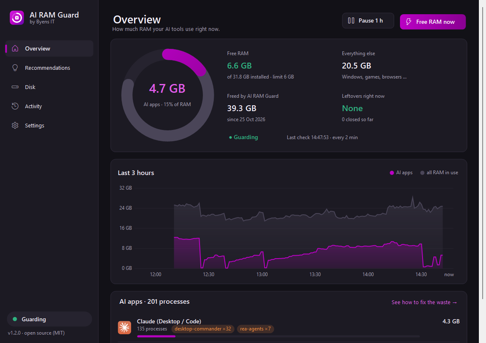

# AI RAM Guard

See how much RAM your AI tools use, and clean up the helpers they leave behind.

**[Download for Windows](https://github.com/byensitmagnus/ai-ram-guard/releases/latest/download/AiRamGuard-Setup.exe)** · **[Download for Mac — beta](https://github.com/byensitmagnus/ai-ram-guard/releases/latest/download/AiRamGuard-mac-universal.dmg)**

[Simple download page](https://byensitmagnus.github.io/ai-ram-guard/?lang=en) · [Dansk](README.da.md)

## Get started

| Windows 10 / 11, 64-bit | Mac, macOS 13 or later |
| --- | --- |
| Download **AiRamGuard-Setup.exe**. Open it and click **Install**. | Download the **DMG**. Open it and drag **AI RAM Guard** to **Applications**. |
| The app opens automatically and starts with Windows. No .NET installation or unzipping. | Open the app from Applications. One download supports Apple Silicon and Intel. Login startup is optional. |

**First-run approval:** these downloads are not backed by a commercial code-signing certificate. Windows may show SmartScreen. The **Mac beta is not notarized by Apple**: after trying to open it, use *System Settings → Privacy & Security → Open Anyway*. [First-open help](docs/install.md#first-open-approval).

## What it does

- Shows RAM usage for Claude, Codex / ChatGPT, Cursor and their background helpers.
- Finds duplicate MCP servers and leftover processes.
- Closes only helpers it previously observed under an AI app, after that app is gone. Active sessions stay open.
- Shows where AI tools and their caches use disk space.

**Windows** also offers config fixes with backup and undo, memory trimming, game mode, and cache moves. **Mac beta** focuses on memory monitoring, proven leftover cleanup and disk usage; it does not have the Windows config editor, cache moves or working-set trimming. [Mac details](macos/README.md).

## Help and technical details

[Installation and updates](docs/install.md) · [Command line](docs/cli.md) · [How it works](docs/how-it-works.md) · [Add an AI app](docs/adding-an-agent.md) · [Report a bug](https://github.com/byensitmagnus/ai-ram-guard/issues) · [All downloads](https://github.com/byensitmagnus/ai-ram-guard/releases)

Free, open source, no account, no telemetry. Made by **Magnus Steinmeier Olsen / [Byens IT](https://byens-it.dk)**. MIT license.
