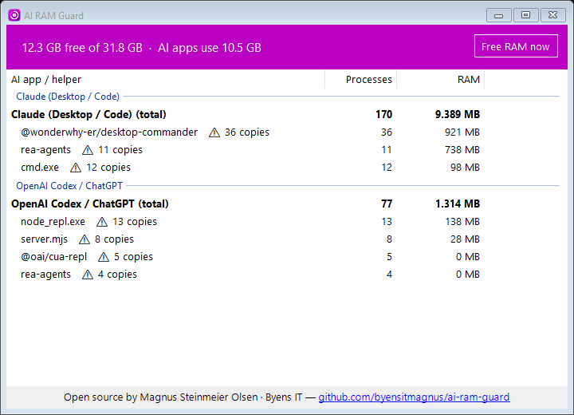

<p align="center">
  
</p>

<p align="center">
  <a href="https://github.com/byensitmagnus/ai-ram-guard/releases/latest"></a>
  <a href="https://github.com/byensitmagnus/ai-ram-guard/actions/workflows/ci.yml"></a>
  <a href="LICENSE"></a>
  
  
</p>

<p align="center"><b>English</b> · <a href="README.da.md">Dansk</a></p>

# AI RAM Guard: fix high memory use from Claude Code, Codex, Cursor and MCP servers

**AI RAM Guard** is a free, open-source Windows tray app and CLI. It shows how much RAM your AI coding tools really use, finds **duplicate and orphaned MCP servers**, and gives the memory back, without closing anything you are working in.

> Built after a 32 GB gaming PC ran out of RAM in the middle of a game. The cause wasn't the game. It was **36 copies of one MCP server** and **25 copies of another**, started by AI sessions that were open in the background, plus helpers whose sessions had closed long ago.

<p align="center"></p>

## Contents
- [Why your AI tools eat RAM](#why-your-ai-tools-eat-ram)
- [What it does](#what-it-does)
- [Install](#install)
- [Use the CLI](#use-the-cli)
- [Supported AI apps](#supported-ai-apps)
- [Is it safe?](#is-it-safe)
- [FAQ](#faq)
- [Roadmap](#roadmap)
- [About](#about)

## Why your AI tools eat RAM

Every AI session (a Claude Code chat, a Codex thread, a Cursor window) **starts its own copy of every MCP server you have configured**. Each copy is a full Node.js or Python process, typically 100–250 MB. So:

| Open sessions | MCP servers configured | Processes | RAM |
|---|---|---|---|
| 1 | 3 | 3 | ~0.5 GB |
| 10 | 3 | 30 | ~5 GB |
| 15 | 4 + npx wrappers | 100+ | **8–10 GB** |

On top of that, when an app crashes or a session ends badly, its MCP servers can be left **orphaned**: still running, still holding RAM, with nobody using them. Task Manager just shows a long list of identical "Node.js JavaScript Runtime" rows and doesn't tell you which app they belong to.

Read more: [Why Claude Code uses so much RAM on Windows](docs/why-ai-tools-use-so-much-ram.md).

## What it does

| | |
|---|---|
| 🔍 **Explains your RAM** | Groups every process under the AI app that owns it (Claude, Codex, Cursor, Windsurf, Gemini CLI …) and names each MCP server, e.g. `@wonderwhy-er/desktop-commander ⚠ 36 copies`. |
| 🧹 **Closes orphans** | MCP servers and `npx` wrappers whose AI session no longer exists are closed. Servers you started yourself from a live terminal are left alone. |
| 🪶 **Frees memory without closing apps** | When free RAM drops below your limit, AI apps' idle memory is moved to the pagefile (`EmptyWorkingSet`). They keep running and page back in when you use them. The window you are using is never touched. |
| 🎮 **Game mode** | While a fullscreen game is in front, a stricter limit applies, so your game gets the RAM. |
| 🖥️ **Tiny tray app** | A ring icon shows used RAM (grey) and the AI share (purple). Double-click for the report. ~30 MB private memory, trims itself between rounds, no Electron. |
| ⌨️ **CLI + JSON** | `airg scan --json` for scripts, dashboards and other tools. |
| 🧩 **Framework** | Agents are plain data in [`profiles.json`](src/AiRamGuard.Core/profiles.json). Add a new AI app with a pull request, or locally with no code. |

## Install

**Download:** grab `AiRamGuard-win-x64.zip` from [Releases](https://github.com/byensitmagnus/ai-ram-guard/releases/latest), unzip, and run `AiRamGuard.exe`. Right-click the tray icon → **Start with Windows**.

**Build from source** (needs the [.NET 8 SDK](https://dotnet.microsoft.com/download/dotnet/8.0)):

```powershell
git clone https://github.com/byensitmagnus/ai-ram-guard
cd ai-ram-guard
dotnet run --project src/AiRamGuard.Tray -c Release
```

Full guide: [docs/install.md](docs/install.md).

## Use the CLI

```text
airg scan                 RAM per AI app, duplicate MCP servers, orphans
airg scan --json          the same as JSON
airg clean --dry-run      show what would be closed / trimmed
airg clean                close orphans and free AI memory now
airg watch --min-free 6   guard continuously (headless version of the tray app)
```

Example output:

```text
RAM: 13.5 GB free of 31.8 GB. AI apps use 9.9 GB.

Claude (Desktop / Code)           166 proc    8,849 MB
   36x @wonderwhy-er/desktop-commander          782 MB  <- duplicate MCP servers
   11x rea-agents                               737 MB  <- duplicate MCP servers
OpenAI Codex / ChatGPT             77 proc    1,301 MB
   13x node_repl.exe                            138 MB  <- duplicate MCP servers
```

All commands: [docs/cli.md](docs/cli.md).

## Supported AI apps

Claude Desktop & Claude Code · OpenAI Codex & ChatGPT desktop · Cursor · Windsurf · VS Code (Copilot / agent extensions) · Gemini CLI · Grok · LM Studio · Ollama, plus **any MCP server** (`@modelcontextprotocol/*`, `npx`, `uvx`, `*-mcp`, `mcp-server-*`).

Missing your tool? It's a few lines of JSON: [docs/adding-an-agent.md](docs/adding-an-agent.md).

## Is it safe?

AI RAM Guard was designed to **never break the work you are doing**:

- It **never closes an AI app** or a session you have open.
- It only closes processes that (1) look like an AI helper or MCP server **and** (2) whose whole parent chain up to the AI app is gone. Before closing, it re-checks that the PID still belongs to the same process.
- Trimming (`EmptyWorkingSet`) doesn't end anything. It's the same mechanism Windows uses itself under memory pressure.
- No network access, no telemetry, no admin rights needed. Everything it does is written to `%LOCALAPPDATA%\AiRamGuard\guard.log`.

Details: [docs/how-it-works.md](docs/how-it-works.md).

## FAQ

<details><summary><b>Why does Claude Code use so much RAM?</b></summary>

Mostly not the model client itself, but the MCP servers it starts, once per session. Ten open sessions × five MCP servers = fifty Node.js processes. Run `airg scan` to see your exact numbers. Also see [the guide](docs/why-ai-tools-use-so-much-ram.md).
</details>

<details><summary><b>How do I kill orphaned MCP server processes on Windows?</b></summary>

`airg clean`. It closes only MCP and helper processes whose AI session is gone. Killing every `node.exe` in Task Manager also kills the servers your live sessions are using.
</details>

<details><summary><b>Why are there so many "Node.js JavaScript Runtime" processes in Task Manager?</b></summary>

Each one is usually an MCP server (or an `npx` wrapper around one) started by an AI app. AI RAM Guard tells you which app and which server.
</details>

<details><summary><b>Will this make my games run better?</b></summary>

If AI tools run in the background while you play: yes, it can free several GB. Game mode trims AI memory earlier while a fullscreen game is in front. It doesn't change the game itself.
</details>

<details><summary><b>Does it work on macOS or Linux?</b></summary>

Not yet. The analysis core is platform-neutral; the process reader is Windows-only. See the roadmap.
</details>

## Roadmap

- [x] v0.1: analysis core, orphan cleanup, working-set trimming, game mode, tray app, CLI, JSON
- [ ] Per-agent caps ("Codex may use at most 3 GB")
- [ ] Suggest config fixes (e.g. "this MCP server is loaded globally but only used in one project")
- [ ] winget / Scoop packages
- [ ] macOS and Linux process readers
- [ ] History graph in the tray app

Ideas and pull requests are welcome. See [CONTRIBUTING.md](CONTRIBUTING.md).

## About

Made by **Magnus Steinmeier Olsen** at **[Byens IT](https://byens-it.dk)**, a Danish gaming-PC builder and IT shop. We build gaming PCs, and we run a lot of AI agents ourselves. This tool came out of fixing our own machines; we're open-sourcing it so nobody else has to choose between their AI tools and their game.

If AI RAM Guard saved you some RAM, please ⭐ the repo. That's what helps other people find it.

MIT © 2026 Magnus Steinmeier Olsen / Byens IT
