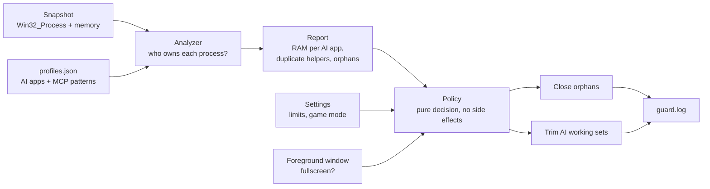

# How AI RAM Guard works

The code is split so the risky part, deciding what to touch, is pure and unit-tested:

| File | Role | Touches the machine? |
|---|---|---|
| [`Analyzer.cs`](../src/AiRamGuard.Core/Analyzer.cs) | Ownership, orphans, duplicate grouping | No |
| [`Policy.cs`](../src/AiRamGuard.Core/Policy.cs) | What to close and trim | No |
| [`Windows.cs`](../src/AiRamGuard.Core/Windows.cs) | Read processes, trim, close, log | Yes |

## Ownership

For every process, the analyzer walks up the parent chain until it reaches a process whose name an agent profile owns (`claude.exe`, `codex.exe`, `Cursor.exe` …). CLI agents without an app process (Gemini CLI) are recognised by their command line.

## Helpers and duplicates

A **helper** is a process whose command line matches a helper pattern: MCP servers, `npx` wrappers, `uvx`, REPL bridges. AI app processes themselves are never helpers. Helpers are grouped by a short key: the npm package (`@scope/name`), the package folder under `node_modules`, the script name or the executable. Three or more copies under one AI app are flagged as duplicates.

## Orphans: the rule

A helper is an orphan when **walking up through helper processes ends at a parent that no longer exists**, or whose PID now belongs to a newer process (Windows reuses PIDs).

So:

| Chain | Orphan? |
|---|---|
| `server ← npx ← cmd /c npx ← claude.exe (running)` | No, owned by Claude |
| `server ← npx ← cmd /c npx ← (gone)` | **Yes** |
| `server ← pwsh ← Windows Terminal` (you started it) | No, `pwsh` is not a helper |
| `node my-app.js ← (gone)` | No, not a helper |

Before closing, the process's start time is compared with the snapshot so a reused PID is never hit.

## Trimming

When free RAM is below the limit (default 6 GB, 10 GB in game mode), every process owned by an AI app, **except the foreground window's**, gets `EmptyWorkingSet`. Windows moves its idle pages to the standby list and pagefile. The process keeps running; pages it touches again come back, so a busy agent doesn't lose anything except a few ms.

Trimming lowers the number in Task Manager's "Memory" column right away and gives the RAM to whatever needs it, such as your game.

## Game mode

If the foreground window covers its whole monitor and doesn't belong to an AI app, the stricter limit applies.

## What it never does

- Close an AI app or a live session
- Close anything that isn't a helper
- Need admin rights, talk to the network or send telemetry
