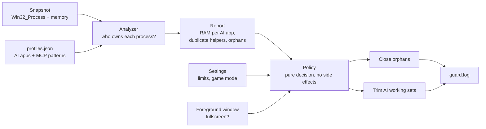

# How AI RAM Guard works

The code is split so the risky part, deciding what to touch, is pure and unit-tested:

| File | Role | Touches the machine? |
|---|---|---|
| [`Analyzer.cs`](../src/AiRamGuard.Core/Analyzer.cs) | Ownership, orphans, duplicate grouping | No |
| [`Policy.cs`](../src/AiRamGuard.Core/Policy.cs) | What to close and trim | No |
| [`Windows.cs`](../src/AiRamGuard.Core/Windows.cs) | Read processes, trim, close, log | Yes |

## Ownership

For every process, the analyzer walks up the parent chain until it reaches a process an agent profile owns (`claude.exe`, `codex.exe`, `Cursor.exe` …). CLI agents without an app process (Gemini CLI) are recognised by their command line, but only when it runs in a script runtime such as `node.exe`, so an editor open on the same path doesn't count.

## Helpers and duplicates

A **helper** is a process whose command line matches a helper pattern: MCP servers, `npx` wrappers, `uvx`, REPL bridges. AI app processes themselves are never helpers. Helpers are grouped by a short key: the npm package (`@scope/name`), the package folder under `node_modules`, the script name or the executable. Three or more copies under one AI app are flagged as duplicates.

## Orphans: the rule

A helper is an orphan when **both** are true:

1. Walking up through helper processes ends at a parent that no longer exists, or whose PID now belongs to a newer process (Windows reuses PIDs).
2. In an earlier scan, AI RAM Guard **saw it running under a live AI app**, started by the app through helpers only. These are remembered in `%LOCALAPPDATA%\AiRamGuard\lineage.json` by PID plus start time.

A dead parent alone proves nothing: apps started with `start`, a launcher or Task Scheduler have one too. Rule 2 is why leftovers that already existed before the first scan are not closed, and why a dev server an agent started in a shell (`claude → pwsh → node server.mjs`) survives the agent.

So:

| Chain | Orphan? |
|---|---|
| `server ← npx ← cmd /c npx ← claude.exe (running)` | No, owned by Claude |
| `server ← npx ← cmd /c npx ← (gone)`, earlier seen under Claude | **Yes** |
| `server ← npx ← (gone)`, never seen under an AI app | No |
| `node server.mjs ← pwsh ← (Claude, gone)` | No, `pwsh` is not a helper |
| `server ← pwsh ← Windows Terminal` (you started it) | No, `pwsh` is not a helper |
| `node my-app.js ← (gone)` | No, not a helper |

Before closing, and before trimming, the process's start time is compared with the snapshot so a reused PID is never hit.

## Trimming

When free RAM is below the limit (default 6 GB, 10 GB in game mode), every process owned by an AI app, **except the app in front**, gets `EmptyWorkingSet`. Windows moves its idle pages to the standby list and pagefile. The process keeps running; pages it touches again come back, so a busy agent doesn't lose anything except a few ms.

"The app in front" is the AI app that owns the foreground window, or, for CLI agents, whose terminal is the foreground window (Windows Terminal is an ancestor of Claude Code running in it). Explorer doesn't count, since it starts nearly everything.

Trimming lowers the number in Task Manager's "Memory" column right away and gives the RAM to whatever needs it, such as your game.

## Game mode

If the foreground window covers its whole monitor and doesn't belong to an AI app, the stricter limit applies.

## Priority

Every round, AI apps that are not in front get **low memory priority** (`SetProcessInformation`, `ProcessMemoryPriority` 2 instead of 5). That takes nothing away while there is RAM to spare; when RAM runs out, Windows repurposes their pages first instead of your game's or browser's.

While a game is in front (game mode), they also get **below-normal CPU priority** and **EcoQoS** (`ProcessPowerThrottling`, the efficiency mode Task Manager marks with a leaf), so the game wins the CPU.

Only values still at Windows' default are changed: a priority you or the app itself chose is kept. The original is put back when you switch to the app or the terminal it runs in (a foreground hook reacts at once), when the game ends, when the guard is paused or turned off, and when AI RAM Guard exits. None of it needs admin rights. The one-shot CLI commands don't change priority, since nothing would be left running to restore it.

## Disk

`airg disk` and the *Disk* page read where each tool writes: its environment variable (user, then machine), npm's `cache=` in `~/.npmrc`, else the tool's documented default. A junction at that path is followed to show the real drive. Sizes don't count what links inside a folder point to.

**Move** copies the files with `robocopy /E /MOVE /XJ`, then sets the tool's own variable (`npm_config_cache`, `UV_CACHE_DIR`, `PIP_CACHE_DIR`, `NUGET_PACKAGES`, `PLAYWRIGHT_BROWSERS_PATH`, `HF_HOME`, `OLLAMA_MODELS`, `TEMP`/`TMP`) for your user:

- The undo record (old raw value and type, or "not set") is saved before anything changes.
- A file is removed from the old folder only after it was copied; files in use stay and are picked up by moving again.
- A cache with junctions or symbolic links in it is not moved. Windows lets only an admin recreate links, so robocopy would leave them behind, split from their files. Hugging Face makes such links in Developer Mode; move that one yourself from an admin prompt (`robocopy /E /MOVE /SL`).
- The variable must point at a cache folder: a drive root, a relative path, or a folder that holds your user folder or app data is refused.
- **Undo** refuses when you pointed the variable somewhere else since, so it never overwrites your own choice. A damaged undo file blocks new moves instead of being overwritten.
- The target must be an empty or new folder on a fixed drive, never a drive root, so **Undo** can move everything in it back.
- Temp files are not copied, only the variables switch.

If you put `TEMP` on a Dev Drive, Microsoft notes that Windows Update needs the `WinSetupMon` filter allowed on it.

## What it never does

- Close an AI app or a live session
- Close anything that isn't a helper it saw an AI app start
- Need admin rights, talk to the network or send telemetry
- Move Claude Code's or Codex's folders, or anything outside a cache folder
